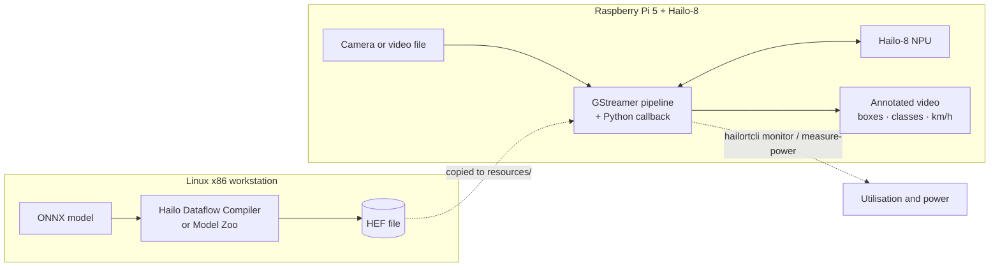
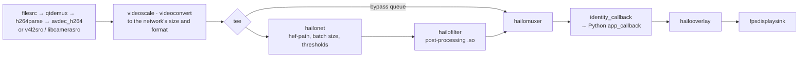
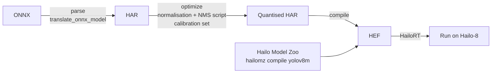

# Smart Digital Junction: architecture

A technical write-up of the Smart Digital Junction proof of concept (ST Engineering, 2024).
It draws on the code in this repo, the set-up guide ([DOCUMENTATION.md](DOCUMENTATION.md)),
the slide decks in [reports/](reports) and the project files. Back to the [README](README.md).

**Contents:**
1. [Goals](#1-goals)
2. [Stack and versions](#2-stack-and-versions)
3. [System context](#3-system-context)
4. [The runtime pipeline](#4-the-runtime-pipeline)
5. [The Python callback](#5-the-python-callback)
6. [Speed estimation](#6-speed-estimation)
7. [The model toolchain](#7-the-model-toolchain)
8. [Benchmarks](#8-benchmarks)
9. [Power, utilisation and cost](#9-power-utilisation-and-cost)
10. [Version pinning](#10-version-pinning)
11. [Decisions and trade-offs](#11-decisions-and-trade-offs)
12. [Limits](#12-limits)
13. [Timeline](#13-timeline)
14. [Next steps](#14-next-steps)

## 1. Goals

The proof of concept set out to show three things:
- **Real time without the network:** local AI on a Raspberry Pi 5 with a Hailo-8 can be
  responsive with no cloud round-trip, so no network latency.
- **Cost-effective:** both the hardware and the energy cost less than a GPU setup.
- **A fair benchmark:** compare the edge setup with a high-end GPU and a network-based
  option. Even if the GPU is faster, the edge setup must be fast enough.

It ran in two steps. **Step 1** asked whether we can use Hailo at all: the same model on
three platforms. **Step 2** asked whether we can build our own applications on it:
detection, classification, tracking and speed estimation together. Each step ended
with a deck in [reports/](reports).

## 2. Stack and versions

| Layer | Component | Version |
|---|---|---|
| Edge hardware | Raspberry Pi 5 (128 GB microSD) + Hailo-8 NPU on PCIe | — |
| OS | Raspberry Pi OS 64-bit (Debian 12) | — |
| NPU runtime | HailoRT and PCIe driver | 4.17 |
| Pipeline elements | Hailo TAPPAS core (`hailonet`, `hailofilter`, `hailomuxer`, `hailooverlay`) | 3.28.2 |
| Media | GStreamer | 1.22 |
| Application | Python, NumPy (< 2), OpenCV, Roboflow `supervision` (≥ 0.20) | Python 3.10 |
| Model compilation | Hailo Dataflow Compiler (DFC) and Hailo Model Zoo, on a Linux x86 workstation | DFC 3.27.0, Python 3.8 |
| Models | YOLOv8 s/m/l, YOLOv6n, YOLOv5s (car), YOLOX; segmentation and pose variants | 11 HEF files in `resources/` |

## 3. System context



Compiling happens once, on the workstation. Inference runs on the edge device without
any network.

## 4. The runtime pipeline

The application subclasses Hailo's `GStreamerApp`. Its `get_pipeline_string()`
([source](https://github.com/sp4ce-cowboy/smart-digital-junction/blob/47e7df92e91134a99e2a8a3d308786f91635297a/basic_pipelines/detection_supervision_tappas328.py#L346-L399))
builds one GStreamer pipeline:



- **The tee and muxer** keep the full-resolution frame alongside the NPU's result. The
  muxer attaches the detections to the frame as metadata.
- **Three sources:** a video file, a USB camera, or the Pi camera, each scaled and
  converted to the network's input size.
- `fpsdisplaysink` reports the frame rate, which is what the benchmarks compare.

## 5. The Python callback

`app_callback` is a GStreamer pad probe that runs on every frame
([source](https://github.com/sp4ce-cowboy/smart-digital-junction/blob/47e7df92e91134a99e2a8a3d308786f91635297a/basic_pipelines/detection_supervision_tappas328.py#L83-L216)):

1. Read the Hailo detections from the buffer's region of interest
   (`roi.get_objects_typed(hailo.HAILO_DETECTION)`), and scale each normalised box to pixels.
2. Build `sv.Detections` (boxes, confidences, class IDs), and drop low-confidence ones.
3. Keep detections inside the road polygon (`sv.PolygonZone`), then run NMS.
4. Track with ByteTrack (`byte_track.update_with_detections`), which gives each vehicle a
   stable `tracker_id`.
5. Estimate speed (section 6), then annotate: boxes, labels with km/h, and traces.

```python
detections = detections.with_nms(threshold=user_data.iou_threshold)
detections = user_data.byte_track.update_with_detections(detections=detections)

points = detections.get_anchors_coordinates(anchor=sv.Position.BOTTOM_CENTER)
points = user_data.view_transformer.transform_points(points=points).astype(int)
for tracker_id, [_, y] in zip(detections.tracker_id, points):
    user_data.coordinates[tracker_id].append(y)
```

The trackers, zone, transformer and annotators are built once, after the pipeline is
created ([source](https://github.com/sp4ce-cowboy/smart-digital-junction/blob/47e7df92e91134a99e2a8a3d308786f91635297a/basic_pipelines/detection_supervision_tappas328.py#L295-L341)),
and kept in the callback's `user_data`. The callback itself stays allocation-light.

## 6. Speed estimation

The method follows [Roboflow's speed estimation](https://blog.roboflow.com/estimate-speed-computer-vision/),
adapted to the Hailo pipeline.

1. **Calibrate once.** Mark the four corners of a stretch of road in the camera image
   (`SOURCE`), and give its real size: `TARGET` is 22 m wide and 80 m long.
2. **Perspective transform.** `cv2.getPerspectiveTransform(SOURCE, TARGET)` gives a
   homography from the camera view to a bird's-eye view in metres
   ([`ViewTransformer`](https://github.com/sp4ce-cowboy/smart-digital-junction/blob/47e7df92e91134a99e2a8a3d308786f91635297a/basic_pipelines/detection_supervision_tappas328.py#L44-L55)).
3. **Track a point.** Each vehicle's bottom-centre point is mapped through the
   homography. Its road position `y` goes into a ring buffer holding one second of history
   (`deque(maxlen=fps)`).
4. **Speed.** With at least half a second of history:

   $$v\ [\text{km/h}] = \frac{|y_\text{latest} - y_\text{oldest}|\ [\text{m}]}{n_\text{frames} / \text{fps}\ [\text{s}]} \times 3.6$$

Points to watch:
- The calibration is per camera position, so the camera must stay fixed.
- Hailo letterboxes the input to 640 × 640 (black bars above and below), and the
  coordinates must account for that.
- `fps` must match the source (25 fps for the test videos).

## 7. The model toolchain



- **Manual pipeline** ([scripts/](scripts)), using `hailo_sdk_client.ClientRunner`:
  - `translate_onnx_model` parses the ONNX graph, with explicit start and end nodes.
  - `load_model_script` adds input normalisation and an NMS post-process, then
    `optimize(calib_dataset)` quantises the full-precision weights to integers, using a
    NumPy calibration set.
  - `compile()` writes the HEF.
  - The drafts are modelled on Edge Impulse's vehicle-detection project. Custom models
    must go this way.
- **Model Zoo pipeline:** `hailomz optimize / compile / profile` wraps the same steps for
  supported models. It is simpler, but limited to the Zoo's list.
- **Compile once, for the right chip.** A HEF targets a specific chip, so Hailo-8 and
  Hailo-8L builds differ. A compile can take up to 24 hours (the workstation's standby
  was disabled for it), and costs about 7 kWh (~$2) per model.

## 8. Benchmarks

YOLOv6n, same Python detection script, on a 90.28 s, 480p, 25 fps clip of moderate
traffic (2,257 frames):

| Platform | Time | Share of clip length | Against real time |
|---|---|---|---|
| Desktop: NVIDIA workstation GPU + AMD Threadripper Pro 5995WX | 66.3 s | 74.6% | 1.34× faster |
| Raspberry Pi 5 | 548.4 s | 609% | ~6× slower |
| **Raspberry Pi 5 + Hailo-8** | **90.55 s** | **~100%** | **real time** |

The Hailo-8 brings the Pi from about 6× slower than real time to real time. That is much
closer to the desktop than to the bare Pi.

## 9. Power, utilisation and cost

Measured on the Pi with `hailortcli measure-power` and `hailortcli monitor`, while the
application ran:

| Model | NPU utilisation |
|---|---|
| YOLOv6n | 10–30% |
| YOLOv8m | 70–90% |
| YOLOv8l | 90–99% |

Average power was **~2.5 W**, and the hardware costs about **$300**.

Operating-cost model: YOLOv8m running 24/7/365 at 99% uptime, at Singapore Power's
tariff of 31.72 ¢/kWh including GST.

| Device | Inference speed | Hardware | Power | Per year |
|---|---|---|---|---|
| RTX 2080 desktop | 20–60 fps | $800 + $1,000 | ~215 W | $591.44 |
| Jetson Orin | 200–250 fps | $1,999 | ~60 W | $165.05 |
| Hailo-8 | 30–60 fps | ~$300 | ~5 W | $13.75 |

All three clear the 20 fps needed for real time with YOLOv8m. The Hailo-8 costs 97.7%
less to run than the RTX desktop, and 91.6% less than the Jetson.

## 10. Version pinning

Hailo's software was changing fast: demo programs broke within a month, and the APIs
looked tightly coupled. So the environment is pinned and documented:

- **Edge:** HailoRT 4.17 and TAPPAS 3.28. The rpi5 examples are pinned to their
  25 Aug 2024 commit, and this repo continues from that state. The full apt package list
  is in [`aptPackages.txt`](aptPackages.txt), so a new setup can `diff` against it.
- **Workstation:** DFC 3.27.0 runs only on Linux x86 and needs Python 3.8, so a custom
  Python is built from source and given its own virtual environment.
- **Shells:** the set-up script is `sh`/`bash`, not `zsh`. DOCUMENTATION.md flags this.

## 11. Decisions and trade-offs

| Decision | Alternatives | Why | Cost |
|---|---|---|---|
| Hailo-8 on a Raspberry Pi 5 | Jetson Orin; a GPU desktop; cloud inference | Real time at ~5 W and ~$300, with no network | Slower than a Jetson; a proprietary compiler and format |
| Use Hailo's GStreamer detection app, with tracking in the Python callback | Run Ultralytics YOLO in Python | Inference stays on the NPU; Python only post-processes | Tied to Hailo's example API and versions |
| `supervision` for zones, NMS, ByteTrack and annotation | Write the tracking by hand | Tested building blocks; the speed method was already proven | One more dependency to pin |
| Model Zoo for supported models; the manual DFC pipeline for custom ones | Manual pipeline only | Zoo compiles are one command | Zoo limited to its list |
| Pin versions and document them | Track the latest Hailo releases | The releases broke examples within weeks | An upgrade path is needed later (section 14) |

## 12. Limits

- The camera must stay fixed: the road calibration is manual and tied to one view.
- Speed is measured along the road's length (`y`) only, from a one-second window.
- Accuracy (mAP) and end-to-end latency were not measured. Raised in the first deck as open
  questions.
- YOLOv8l saturates the NPU. For dense traffic, YOLOv8m is the safe maximum, to avoid
  overheating.
- HailoRT 4.17 does not support the full current Hailo API.

## 13. Timeline

From the project files.

| When (2024–25) | Milestone |
|---|---|
| August | Proof-of-concept plan: objectives, set-up, benchmarking criteria |
| September | Step 1 benchmarks across three platforms; comparison video |
| October | Model toolchain (DFC and Model Zoo); issues and next steps presented |
| December | Step 2: speed estimation with YOLOv8m; power, utilisation and cost analysis |
| January 2025 | Code, slides and the set-up and hand-over guide published here |

## 14. Next steps

- **Upgrade the stack** (HailoRT, DFC, Model Zoo) and re-clone the latest rpi5 examples.
  Then merge the new `detection.py` with the speed-estimation code again.
- **Measure accuracy and latency**, and test the limits of the Hailo-8.
- **More applications:** licence-plate recognition, counting, and using the custom class
  labels.
- **Custom models** through the manual DFC pipeline, and Hailo-15 for larger models
  (up to YOLOv8x in theory).
