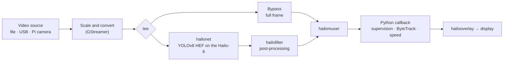

# Smart Digital Junction

**Real-time vehicle detection, tracking and speed estimation on a $300, 5 W edge device.** 
An AI-on-edge traffic-monitoring proof of concept at ST Engineering: YOLOv8 on a
[Hailo-8](https://hailo.ai/products/ai-accelerators/hailo-8-ai-accelerator/) neural processing unit attached to a
[Raspberry Pi 5](https://www.raspberrypi.com/products/raspberry-pi-5/), instead of a GPU workstation.

> [!NOTE]
> This was written by [Claude](https://docs.anthropic.com/en/docs/claude-code) using my
> [agentic-repo-analysis](https://github.com/sp4ce-cowboy/agentic-workflows) skill, from the
> project's code, git history and documentation. The original set-up and hand-over guide is in
> **[DOCUMENTATION.md](DOCUMENTATION.md)**, and the technical write-up in **[ARCHITECTURE.md](ARCHITECTURE.md)**.

  

## At a glance

| | |
|---|---|
| **What** | A proof of concept for AI on the edge: detect, classify, track and estimate the speed of vehicles in real time on a small edge device, with no GPU workstation or cloud |
| **Where** | ST Engineering, Singapore |
| **Context** | Software engineering intern, 2024 |
| **My role** | The engineer on the proof of concept, end to end: hardware and toolchain set-up, benchmarks, the speed-estimation application, model compilation, the cost analysis and the documentation |
| **Hardware** | Raspberry Pi 5 + Hailo-8 NPU; a Linux x86 workstation for model compilation |
| **Status** | Proof of concept complete; fully documented for the next engineer |

## The question

Real-time object detection on video usually needs a GPU workstation, which is expensive to
buy and to run around the clock. Could a Raspberry Pi 5 with a Hailo-8 NPU do the job
at a traffic junction? The project answered it in two steps:

1. **Can we use Hailo?** Benchmark the same model on three platforms.
2. **Can we build our own applications on it?** Run detection, classification, tracking
   and speed estimation together, and measure power, utilisation and cost.

## Results

**Step 1: speed.** YOLOv6n on a 90.3-second, 480p, 25 fps traffic video (2,257 frames):

| Platform | Time | Against real time |
|---|---|---|
| Desktop PC, NVIDIA workstation GPU + AMD Threadripper Pro 5995WX | 66.3 s | 1.34× faster |
| Raspberry Pi 5 alone | 548.4 s | about 6× slower |
| **Raspberry Pi 5 + Hailo-8** | **90.6 s** | **real time** |

**Step 2: a real application.** YOLOv8m detection, ByteTrack tracking and speed estimation:

| Measure | Result |
|---|---|
| Average power | ~2.5 W |
| NPU utilisation | 10–30% (YOLOv6n), 70–90% (YOLOv8m), 90–99% (YOLOv8l) |
| Hardware cost | ~$300 |
| Largest model | YOLOv8l at ~100% NPU load; YOLOv8m for dense traffic, to avoid overheating |

**Running cost**, for YOLOv8m inference 24/7 at Singapore's electricity tariff
(31.72 ¢/kWh), from the project's cost analysis:

| Device | Speed | Hardware | Power | Per year |
|---|---|---|---|---|
| RTX 2080 desktop | 20–60 fps | ~$1,800 | ~215 W | $591.44 |
| Jetson Orin | 200–250 fps | $1,999 | ~60 W | $165.05 |
| **Hailo-8** | **30–60 fps** | **~$300** | **~5 W** | **$13.75** |

That is **97.7% lower** operating cost than the RTX setup and **91.6% lower** than the Jetson,
at the same model accuracy. Compiling a model for the NPU takes up to a day, but only once.
It costs about $2 (~7 kWh).

## How it works

1. A GStreamer pipeline feeds frames to the NPU, which runs a compiled YOLOv8 model (HEF).
2. A Python callback turns the NPU's detections into `supervision` detections. It keeps
   only those inside the road polygon, applies NMS, and tracks each vehicle with ByteTrack.
3. A perspective transform maps the camera view to a bird's-eye view of the road in
   metres. The distance each vehicle moves over the last second gives its speed in km/h.
4. Boxes, labels and traces are drawn on the video.

Models get onto the NPU through the Hailo Dataflow Compiler: ONNX → parsed (HAR) →
quantised with a calibration set → compiled (HEF). The Hailo Model Zoo is the shortcut for
supported models. Details in [ARCHITECTURE.md](ARCHITECTURE.md).

## Skills shown

| Skill | Where it shows | Docs |
|---|---|---|
| **Edge AI deployment**  | YOLO models run on the Hailo-8 through HailoRT and TAPPAS. Power and utilisation are measured with `hailortcli`. See [DOCUMENTATION.md › Speed Estimation Benchmarking](DOCUMENTATION.md#speed-estimation-benchmarking) | [Hailo](https://hailo.ai/developer-zone/) |
| **Video pipelines**  | Source, scaling, NPU inference, muxing, callback and overlay in one pipeline: [`get_pipeline_string`](https://github.com/sp4ce-cowboy/smart-digital-junction/blob/47e7df92e91134a99e2a8a3d308786f91635297a/basic_pipelines/detection_supervision_tappas328.py#L346-L399) | [GStreamer](https://gstreamer.freedesktop.org/documentation/) |
| **Multi-object tracking**  | NPU detections turned into `sv.Detections`, filtered by polygon zone and NMS, then tracked with ByteTrack: [callback](https://github.com/sp4ce-cowboy/smart-digital-junction/blob/47e7df92e91134a99e2a8a3d308786f91635297a/basic_pipelines/detection_supervision_tappas328.py#L118-L166), [set-up](https://github.com/sp4ce-cowboy/smart-digital-junction/blob/47e7df92e91134a99e2a8a3d308786f91635297a/basic_pipelines/detection_supervision_tappas328.py#L295-L308) | [ByteTrack in supervision](https://supervision.roboflow.com/latest/trackers/) |
| **Speed estimation (perspective transform)**  | A homography from the camera view to road coordinates in metres: [`ViewTransformer`](https://github.com/sp4ce-cowboy/smart-digital-junction/blob/47e7df92e91134a99e2a8a3d308786f91635297a/basic_pipelines/detection_supervision_tappas328.py#L44-L55). Speed from a one-second track history: [speed](https://github.com/sp4ce-cowboy/smart-digital-junction/blob/47e7df92e91134a99e2a8a3d308786f91635297a/basic_pipelines/detection_supervision_tappas328.py#L167-L189) | [getPerspectiveTransform](https://docs.opencv.org/4.x/da/d54/group__imgproc__transform.html) |
| **Model compilation & quantisation**  | ONNX → HAR → quantised HAR → HEF with the Dataflow Compiler: [`modelparser.py`](scripts/modelparser.py), [`modeloptimizer.py`](scripts/modeloptimizer.py), [`modelcompiler.py`](scripts/modelcompiler.py); and `hailomz compile` for Model Zoo models | [Hailo Model Zoo](https://github.com/hailo-ai/hailo_model_zoo) |
| **Benchmarking & cost analysis** | Three-platform speed benchmark, and power, utilisation and 24/7 operating-cost comparisons: [reports/](reports) | — |
| **Embedded Linux** | Raspberry Pi OS set-up, pinned package versions ([`aptPackages.txt`](aptPackages.txt)), a custom Python 3.8 build for the compiler, shell set-up scripts | [Raspberry Pi](https://www.raspberrypi.com/documentation/) |
| **Technical documentation** | A 450-line set-up and hand-over guide: [DOCUMENTATION.md](DOCUMENTATION.md) | — |

The pipeline builds on Hailo's [Raspberry Pi 5 examples](https://github.com/hailo-ai/hailo-rpi5-examples) (MIT), pinned to their 25 Aug 2024 commit, and on Roboflow's [speed-estimation method](https://blog.roboflow.com/estimate-speed-computer-vision/).

## By the numbers

| | |
|---|---|
| Published | January 2025 (24 commits) |
| Code | about 1,400 lines of Python (including Hailo's example pipelines), shell set-up scripts |
| Documentation | about 1,100 lines of Markdown, 3 slide decks |
| Models | 11 HEF models (YOLOv5/v6/v8 and YOLOX, for detection, segmentation and pose), 13 test videos |

## On my resume

- Proved real-time edge AI for traffic monitoring at ST Engineering by deploying YOLOv8 detection, ByteTrack tracking and speed estimation on a Raspberry Pi 5 with a Hailo-8 NPU. It processed 25 fps video in real time (90.6 s for a 90.3 s clip), against about 6× slower than real time on the Pi's CPU alone.
- Built the speed-estimation application on Hailo's GStreamer/TAPPAS pipeline in Python. It converts NPU detections into supervision objects, then applies polygon-zone filtering, NMS, ByteTrack and an OpenCV perspective transform to estimate vehicle speeds in km/h.
- Benchmarked edge against GPU platforms and modelled 24/7 operating cost: ~2.5 W average power, and an estimated 97.7% lower annual energy cost than an RTX 2080 setup (91.6% lower than a Jetson Orin) at the same YOLOv8m accuracy.
- Compiled ONNX models into Hailo executables with the Hailo Dataflow Compiler (parsing, integer quantisation with a calibration set, compilation) and the Hailo Model Zoo. Wrote a 450-line set-up and hand-over guide covering version pinning and the full toolchain.
